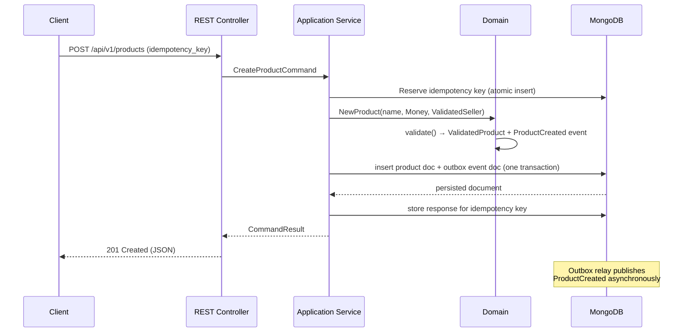
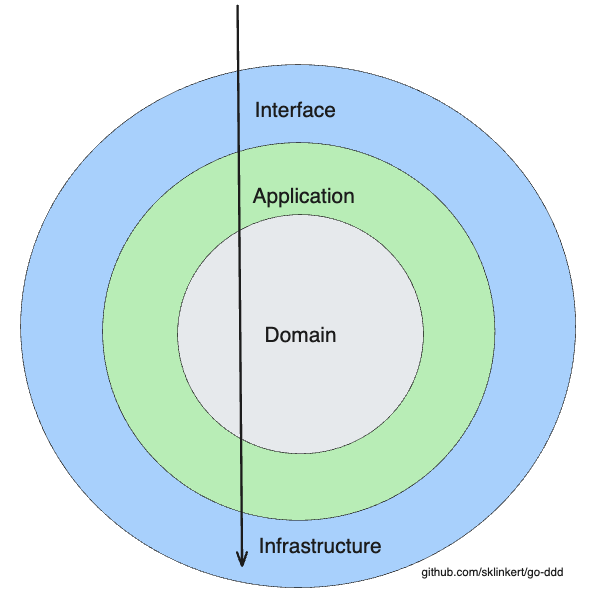

# dev-colab-hub backend

The backend service for **dev-colab-hub**. It's currently scaffolded on [`go-ddd`](https://github.com/sklinkert/go-ddd), an opinionated Go DDD/CQRS template — the layered architecture (domain/application/infrastructure/interface), idempotent command handling, and transactional outbox are the real, current foundation. The `Seller`/`Product` example domain is the template's inherited placeholder, pending replacement with dev-colab-hub's actual domain (see the [`document`](../document) repo for the product spec).

>  **New to the DDD/CQRS patterns used here? [Start with the architecture tutorial →](https://dev-colab-hub.github.io/backend/)**
> A nine-chapter walkthrough of Domain-Driven Design, using this codebase as the running example.

## Architecture Highlights

- **Model-first defaults** – Onion architecture keeps the domain pure while application services orchestrate infrastructure concerns.
- **Battle-tested patterns** – Commands, queries, repositories, value objects, domain events, and soft deletes mirror patterns used in real-world enterprise applications.
- **Idempotent pipelines** – Race-safe idempotency keys (atomic reservation, no check-then-write) make every command retry-safe.
- **Domain events + outbox** – State changes and their events are persisted together; a relay publishes them with at-least-once delivery.
- **Idempotent bootstrap** – `EnsureIndexes` creates the indexes the repositories rely on at startup; safe to run on every boot instead of a separate migration tool.

## What's In Here Today

- `Seller`/`Product` example domain inherited from the template — demonstrates aggregates, a `Money` value object, cross-module interactions, and validation rules, but is **not** dev-colab-hub's actual domain yet.
- Layered modules under `internal/` for `domain`, `application`, `infrastructure`, `interface`, plus `testhelpers` for fixture reuse.
- Executable entrypoint at `cmd/api/main.go` ready to wire adapters or frameworks of your choice.
- MongoDB document repositories under `internal/infrastructure/db/mongodb`, with indexes ensured idempotently at startup.
- [OpenAPI spec](api/openapi.yaml), `/healthz` + `/readyz` probes, and a one-command Docker Compose stack.

## Tech Stack Essentials

- **Go 1.26** with idiomatic patterns and testify-powered tests.
- **Echo v4** HTTP stack for REST endpoints.
- **mongo-driver/v2** for MongoDB access, using multi-document transactions for the transactional outbox (requires Mongo to run as a replica set — see `docker-compose.yml`).
- **Testcontainers** integration to provision disposable MongoDB (single-node replica set) instances during tests.
- **google/uuid** helpers for deterministic ID generation inside the domain.
- **golangci-lint** for static analysis, plus a `Makefile`, `Dockerfile`, and `docker-compose.yml` for a one-command local stack.

## Design Principles in Action

Domain-Driven Design connects implementation to an evolving model. The current example models a simple marketplace where `Sellers` manage `Products`, exercising aggregates, value objects, and validation flows.

Anatomy of a write request:



## Documentation

📚 **[DDD from zero: the full tutorial](https://dev-colab-hub.github.io/backend/)** — nine chapters from "why DDD" to entities, value objects, aggregates, repositories, CQRS, the outbox, idempotency, and testing, all anchored to this codebase.

📖 **[Comprehensive DDD & CQRS Principles Guide](DDD_CQRS_PRINCIPLES.md)** - how these patterns are applied here, and how to extend them to dev-colab-hub's actual domain.

📋 **[`document`](../document) repo** — SRS, sprint plans, and user stories: the source of truth for *what* this backend should actually do.

## Repository Structure




- `domain`: The heart of the software, representing business logic and rules.
    - `entities`: Fundamental objects within our system, like `Product` and `Seller`. Contains basic validation logic.
- `application`: Contains use-case specific operations that interact with the domain layer.
- `infrastructure`: Supports the higher layers with technical capabilities like database access.
    - `db`: Database access and models.
    - `repositories`: Concrete implementations of our storage needs.
- `interface`: The external layer which interacts with the outside world, like API endpoints.
    - `api/rest`: Handlers or controllers for managing HTTP requests and responses.

## Further principles

- Domain
  - Must not depend on other layers.
  - Provides infrastructure with interfaces, but must not access infrastructure.
  - Implements business logic and rules.
  - Executes validations on entities. Validated entities are passed to the infrastructure layer.
  - Domain layer sets defaults of entities (e.g. uuid for ID or creation timestamp). Don't set defaults in the infrastructure layer or even database!
  - Do not leak domain objects to the outside world.
- Application
  - The glue code between the domain and infrastructure layer.
- Infrastructure
   - Repositories are responsible for translating a domain entity to a database model and retrieving it. No business logic is executed here.
   - Implements interfaces defined by the domain layer.
   - Implements persistence logic like accessing a postgres or mysql database.
   - When writing to storage, read written data before returning it. This ensures that the data is written correctly.

## Best Practices

- Don't return validated entities from read methods in the repository. Instead, return the domain entity type directly.
  - Validations will change over time. You don't want to migrate all the data in your database. Instead, you should guarantee you can always load historical data, regardless of how your validation logic has evolved.
  - Otherwise, you won't be able to read data from the database that was written with a different validation logic. You will have to handle errors at runtime.
  - Push validation to the write side-creation (NewX) and update methods - where you must enforce invariants anyway.
- Don't put default values (e.g current timestamp or ID) in the database. Set them in the domain layer (factory!) for several reasons:
  - It's quite dangerous to have two sources of truth.
  - It's easier to test the domain layer.
  - Databases can get replaced, and you don't want to have to change all your default values. 
- Always read the entity after write in the infrastructure layer.
  - This ensures that the data is written correctly, and we are never operating on stale data.
- `find` vs `get`:
  - `find` methods can return null or an empty list.
  - `get` methods must return a value. If the value is not found, throw an error.
- Deletion: Always use soft deletion. Create a `deleted_at` column in your database and set it to the current timestamp when deleting an entity. This way, you can always restore the entity if needed.

## CQRS and Idempotency

### Command Query Responsibility Segregation (CQRS)
CQRS separates read operations (queries) from write operations (commands) in your application. In this codebase:
- **Commands** modify state (CreateSellerCommand, CreateProductCommand, UpdateSellerCommand)
- **Queries** retrieve data without side effects (FindAllSellers, FindSellerById)

This separation enables different optimization strategies:
- **Write optimization**: Commands can use normalized schemas, ACID transactions, and strong consistency
- **Read optimization**: Queries can use denormalized views, caching, read replicas, or even different databases (e.g., PostgreSQL for writes, Elasticsearch for reads)
- **Scalability**: Read and write workloads can be scaled independently based on actual usage patterns
- **Performance**: Complex queries don't impact write performance, and write locks don't block read operations

### Idempotency Keys
Idempotency ensures that multiple identical requests have the same effect as a single request. This is crucial for handling network failures and retries in distributed systems. Implementation:
- Every mutating endpoint (create, update, **and delete**) accepts an optional key. The conventional `Idempotency-Key` HTTP header is preferred; an `idempotency_key` field in the JSON body is still honored as a fallback, and the header wins when both are sent
- The key is **reserved atomically** (an insert against a unique index; a duplicate-key error means another request already holds it), so two concurrent requests with the same key can never both execute — no check-then-write race
- A completed request returns its cached response; a still-running one returns an "in progress" error so the client retries later
- Reusing a key with a **different payload** is rejected instead of silently returning the wrong cached response
- If the command fails, the reservation is released so the client can retry; reservations orphaned by a crash expire after a TTL

This prevents duplicate entities from being created when clients retry failed requests.

### Domain Events and the Transactional Outbox

Aggregates record events (e.g. `ProductCreated`) when something business-relevant happens. Instead of publishing them directly to a broker — which risks losing events when the process crashes between the DB commit and the publish — events are stored in an `outbox_events` collection, inserted in the same multi-document transaction as the aggregate write. A relay polls the outbox and publishes unpublished events with at-least-once delivery. See `internal/domain/events/` and `internal/infrastructure/outbox/`.

## Indexes

MongoDB is schemaless, so there's no forward/backward migration tool: `mongodb.EnsureIndexes` (`internal/infrastructure/db/mongodb/indexes.go`) creates the indexes the repositories rely on — a unique index on `idempotency_records.key`, a partial index on unpublished `outbox_events`, and `deleted_at`/`seller_id` lookup indexes. `CreateIndexes` is idempotent, so this runs on every `cmd/api` startup instead of being a separate step.

## Getting Started

> Requires **Go 1.26+**. Run `make help` to see all available targets.

### Quickstart with Docker Compose

Bring up MongoDB (as a single-node replica set, required for the transactional outbox) and start the API in one command:

```bash
make docker-up        # docker compose up --build
# API is now available on http://localhost:8080
make docker-down      # tear everything down
```

### Try the API in 30 seconds

Create a seller:

```bash
curl -s -X POST http://localhost:8080/api/v1/sellers \
  -H 'Content-Type: application/json' \
  -d '{"name": "Acme Corp", "idempotency_key": "create-acme-1"}'
```

```json
{"id":"0197a3c2-...","name":"Acme Corp","created_at":"2026-07-14T09:00:00Z","updated_at":"2026-07-14T09:00:00Z"}
```

Create a product for that seller (prices are integer minor units — never floats):

```bash
curl -s -X POST http://localhost:8080/api/v1/products \
  -H 'Content-Type: application/json' \
  -d '{"name": "Wooden Chair", "price_minor_units": 4999, "currency": "EUR", "seller_id": "<seller-id-from-above>"}'
```

```json
{"id":"0197a3c3-...","name":"Wooden Chair","price_minor_units":4999,"currency":"EUR","seller_id":"0197a3c2-...","created_at":"...","updated_at":"..."}
```

Replay a request with the same `idempotency_key` — you get the cached response back instead of a duplicate seller:

```bash
curl -s -X POST http://localhost:8080/api/v1/sellers \
  -H 'Content-Type: application/json' \
  -d '{"name": "Acme Corp", "idempotency_key": "create-acme-1"}'
# → identical response, no second row created
```

List products and check service health:

```bash
curl -s http://localhost:8080/api/v1/products
curl -s http://localhost:8080/readyz
```

The full API is described in the [OpenAPI spec](api/openapi.yaml).


### Local development

1. Clone this repository:
```bash
git clone https://github.com/dev-colab-hub/backend.git
cd backend
go mod download
```

2. Start a local MongoDB replica set (or use `make docker-up`, which starts the whole stack including the app):
```bash
docker run -d --name mongo -p 27017:27017 mongo:7 --replSet rs0
docker exec mongo mongosh --quiet --eval "rs.initiate({_id: 'rs0', members: [{_id: 0, host: 'localhost:27017'}]})"
```

3. Run the application:
```bash
export MONGO_URI="mongodb://localhost:27017/?replicaSet=rs0"
make run            # or: go run ./cmd/api
# Indexes are created automatically on startup (see EnsureIndexes).
```

### Common Make targets

```bash
make build        # build the server binary into ./bin
make test         # run all tests with the race detector (needs Docker)
make test-unit    # run only tests that don't require Docker
make lint         # run golangci-lint
make fmt          # format the code (gofmt + goimports)
```

### License
Distributed under the MIT License. See LICENSE for more information.
